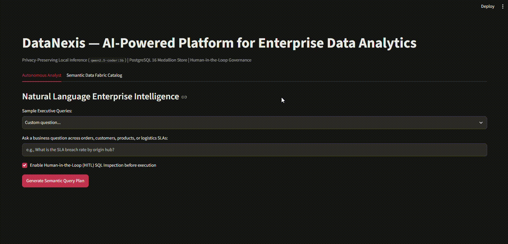
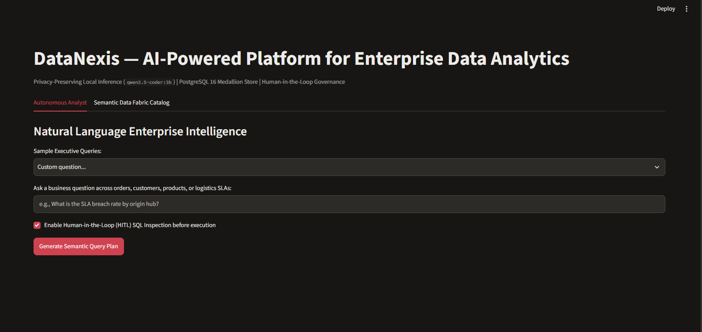
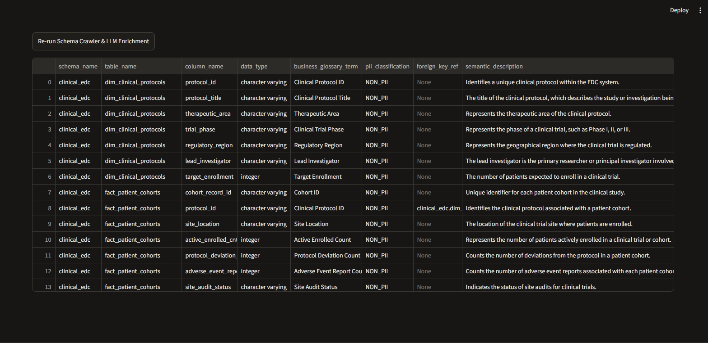
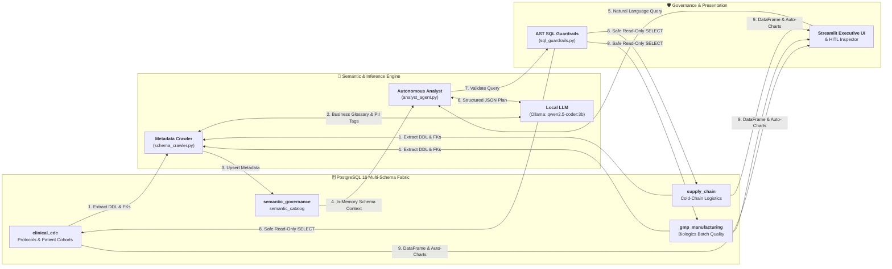

<div align="center">


[](https://www.python.org/)
[](https://www.postgresql.org/)
[](https://ollama.com/)
[](https://streamlit.io/)
[]()

<div align="center">

🏆 **Awarded "Most Innovative Project"** at the Enterprise Data Analytics Hackathon 

</div>

> **Synopsis:** *DataNexis is an AI-powered enterprise data platform that unifies fragmented data into a governed data fabric, adds business context through an automated semantic layer, and enables users to query data in natural language to get instant insights and visual dashboards.*

[The Problem & Impact](#-problem-statement--enterprise-impact) • [Live Walkthrough](#-live-platform-walkthrough) • [System Architecture](#-system-architecture) • [Quickstart](#-local-setup--execution) • [Future Features & Roadmap](#-future-features--delivery-roadmap)

</div>

---

## 🎯 Problem Statement & Enterprise Impact

### The Challenge
Modern enterprises generate vast, fragmented data across isolated operational silos that require heavy manual effort to analyze. Business and clinical teams face constant delays and bottlenecks due to dependency on technical SQL developers—resulting in slow decision-making and limited operational visibility caused by the lack of a unified, governed data intelligence system.

### How DataNexis Solves It
DataNexis bridges the gap between raw, multi-schema enterprise databases and executive decision-makers using **100% local, privacy-preserving AI**—ensuring zero sensitive enterprise data ever leaves the local network.

<table>
  <tr>
    <th width="50%">⚙️ Technical Impact</th>
    <th width="50%">📈 Business Impact</th>
  </tr>
  <tr>
    <td>
      <ul>
        <li><b>AI-Driven Semantic Access:</b> Automated metadata crawling and LLM enrichment map raw schemas into business terminology with minimal manual effort.</li>
        <li><b>Zero Data Egress:</b> Runs completely offline via <code>qwen2.5-coder:3b</code> and PostgreSQL 16, eliminating cloud API data-leak risks.</li>
        <li><b>Hallucination-Free Execution:</b> Grounded in real-time foreign-key topology and deterministic AST read-only validation.</li>
      </ul>
    </td>
    <td>
      <ul>
        <li><b>Faster Executive Decisions:</b> Eliminates multi-day BI ticket queues through instant self-service natural language insights.</li>
        <li><b>Automated Visual Storytelling:</b> Translates plain-English questions directly into governed SQL, statistical summaries, and interactive charts.</li>
        <li><b>Built-In Regulatory Compliance:</b> Enforces domain isolation and Human-in-the-Loop (HITL) query governance out of the box.</li>
      </ul>
    </td>
  </tr>
</table>

---

## 🎬 Live Platform Walkthrough

> *Drop your screen recording and screenshots into `assets/` to render them directly on your repository homepage.*

<div align="center">
  
  <br/>
  <sub><b>Figure 1:</b> End-to-end natural language query execution, SQL lineage inspection, and automated chart rendering in DataNexis.</sub>
</div>

<br/>

| 🔍 Autonomous Analyst & HITL SQL Inspector | 🗂️ Semantic Data Fabric Governance Catalog |
| :---: | :---: |
|  |  |
| *Real-time SQL generation, guardrail verification, and visual analytics* | *Automated schema topology, foreign-key lineage, and PII classification* |

---

## 🏗️ System Architecture

DataNexis implements a **4-stage governed data intelligence pipeline** anchored on a multi-schema Life Sciences enterprise domain model (`clinical_edc`, `gmp_manufacturing`, `supply_chain`, and `semantic_governance`).



### Core Architectural Pillars

<details>
<summary><b>1. Multi-Schema Domain Isolation (Enterprise Data Modeling)</b></summary>
<br/>
Rather than flattening enterprise records into a monolithic table, DataNexis enforces strict domain separation mirroring real-world biopharma regulatory boundaries:

* **`clinical_edc`**: Electronic Data Capture housing `dim_clinical_protocols` and `fact_patient_cohorts` (enrollment metrics, protocol deviations, adverse events).
* **`gmp_manufacturing`**: Good Manufacturing Practice records in `fact_batch_records` (facility plants, biologic yield purity percentages, impurity assays, batch dispositions).
* **`supply_chain`**: Cold-chain logistics in `fact_cold_chain_shipments` (origin hubs, transit durations, carrier SLAs, 2–8°C temperature excursion flags).
* **`semantic_governance`**: Centralized metadata repository (`semantic_catalog`) tracking column types, foreign-key lineage, glossary definitions, and PII tags.
</details>

<details>
<summary><b>2. Automated Semantic Layer & Hallucination Prevention</b></summary>
<br/>
Small open-weights models (`3B` parameters) often hallucinate non-existent dimension tables when translating natural language to SQL. DataNexis eliminates this through:

* **Foreign-Key Topology Extraction:** Inspects PostgreSQL `information_schema` constraints to inject explicit join paths (`[FK->clinical_edc.dim_clinical_protocols(protocol_id)]`) into the prompt context.
* **Resilient JSON Structured Output:** Enforces deterministic JSON schema generation with an 800-token generation ceiling and regex recovery safeguards so local inference never breaks downstream UI rendering.
</details>

<details>
<summary><b>3. Deterministic SQL Guardrails & Human-in-the-Loop (HITL)</b></summary>
<br/>

* **Read-Only AST Enforcement:** Every LLM-generated SQL statement passes static validation (`sql_guardrails.py`) prior to execution—strictly blocking `INSERT`, `UPDATE`, `DELETE`, `DROP`, `ALTER`, or multi-statement injection attempts.
* **HITL Inspection Toggle:** Analysts and data stewards can inspect, modify, and approve generated SQL queries before execution against PostgreSQL.
</details>

---

## 💡 Sample Executive Queries

Test DataNexis with cross-domain natural language questions right out of the box:

| Domain Scope | Sample Natural Language Prompt | What DataNexis Executes |
| :--- | :--- | :--- |
| **Cross-Schema Join** *(Clinical + GMP)* | *"Compare average batch yield purity and total active enrolled patients across each therapeutic area."* | Joins `dim_clinical_protocols`, `fact_patient_cohorts`, and `fact_batch_records` across two schemas. |
| **Manufacturing Quality** *(GMP Domain)* | *"Show the average yield purity percentage and average impurity ppm grouped by facility plant."* | Aggregates quality metrics across manufacturing sites and renders a comparative bar chart. |
| **Logistics & SLA Risk** *(Supply Chain)* | *"List each logistics carrier with their total shipments, average transit duration in hours, and count of temperature excursions."* | Evaluates cold-chain compliance and highlights carrier temperature excursion counts. |

---

## 📂 Repository Structure

```text
DataNexis/
├── assets/                       # Demo GIFs and UI screenshots
├── config/
│   └── settings.py               # Environment & connection settings
├── data/
│   └── seed/
│       └── init_fabric_db.py     # Multi-schema DDL & synthetic Life Sciences data seeder
├── src/
│   ├── agent/
│   │   ├── analyst_agent.py      # Semantic context builder & local LLM Text-to-SQL engine
│   │   └── sql_guardrails.py     # Deterministic read-only SQL validation
│   ├── fabric/
│   │   └── schema_crawler.py     # PostgreSQL metadata crawler & LLM semantic enricher
│   └── ui/
│       └── app.py                # Streamlit interactive dashboard & HITL SQL inspector
├── .env.example                  # Environment variable template
├── .gitignore
├── requirements.txt
└── README.md
```

---

## 🚀 Local Setup & Execution

### 1. Prerequisites
* **Python 3.11+**
* **PostgreSQL 16** running locally
* **[Ollama](https://ollama.com/)** installed with `qwen2.5-coder:3b`:
  ```bash
  ollama pull qwen2.5-coder:3b
  ```

### 2. Clone & Configure Environment
```bash
git clone [https://github.com/](https://github.com/)<your-username>/DataNexis.git
cd DataNexis
python -m venv .venv
```

Activate your virtual environment and install dependencies:
```powershell
# Windows PowerShell
.\.venv\Scripts\Activate.ps1
pip install -r requirements.txt
```

Copy `.env.example` to `.env` and add your local PostgreSQL credentials:
```env
POSTGRES_HOST=localhost
POSTGRES_PORT=5432
POSTGRES_DB=semantic_fabric_db
POSTGRES_USER=postgres
POSTGRES_PASSWORD=your_password
OLLAMA_MODEL=qwen2.5-coder:3b
```

### 3. Initialize Multi-Schema Store & Sync Semantic Catalog
```powershell
$env:PYTHONPATH="."
python -m data.seed.init_fabric_db
python -m src.fabric.schema_crawler
```

### 4. Launch DataNexis
```powershell
streamlit run src/ui/app.py
```

---

## 🔮 Future Features & Delivery Roadmap

We designed **DataNexis** with a modular architecture so it can evolve seamlessly from a local single-node prototype into a full-scale enterprise intelligence platform. Here is what we can deliver in upcoming releases:

### Phase 1: Enterprise Self-Service & Collaboration Features
- [ ] **Automated Executive Report Export (PDF / PowerPoint / CSV):** One-click export of natural language query results, SQL lineage, and interactive charts into boardroom-ready executive briefings.
- [ ] **Multi-Turn Conversational Follow-Ups:** Enable analysts to ask follow-up questions in context (e.g., *"Now filter those results only for Phase III trials in Europe"* or *"Break that down by logistics carrier"*).
- [ ] **Scheduled KPI Alerts & Anomaly Digests:** Allow business users to save natural language queries as automated background monitors that trigger alerts when metrics cross thresholds (e.g., batch yield purity dropping below 98% or cold-chain temperature excursions).
- [ ] **Saved Query Library & Team Workspaces:** Pin frequently used executive dashboards and share verified natural language insights across clinical, manufacturing, and supply chain teams.

### Phase 2: Scale, Security & Autonomous Reliability
- [ ] **Hybrid Vector Semantic Retrieval (`pgvector`):** Replace full-catalog prompt injection with dense + lexical schema retrieval so DataNexis scales effortlessly across enterprise warehouses with 500+ tables.
- [ ] **Self-Healing SQL Reflection Loop:** Automatically capture PostgreSQL execution errors (e.g., `UndefinedColumn`, `GroupingError`) and feed tracebacks back to `qwen2.5-coder:3b` for autonomous query repair before surfacing errors to the user.
- [ ] **Dynamic PII Masking & Column-Level RBAC:** Enforce query-time data masking driven directly by the `pii_classification` metadata tags in `semantic_governance.semantic_catalog`.
- [ ] **Execution Accuracy Benchmarking Suite:** Introduce an automated evaluation harness of 50+ domain-specific NL-to-SQL test pairs to benchmark `qwen2.5-coder:3b` against `7B` and `Llama-3.1-8B` models.

---

<div align="center">
  <sub>Built with Python, PostgreSQL 16, and Local LLM Inference • Designed for Enterprise Data Governance & Self-Service Intelligence</sub>
</div>